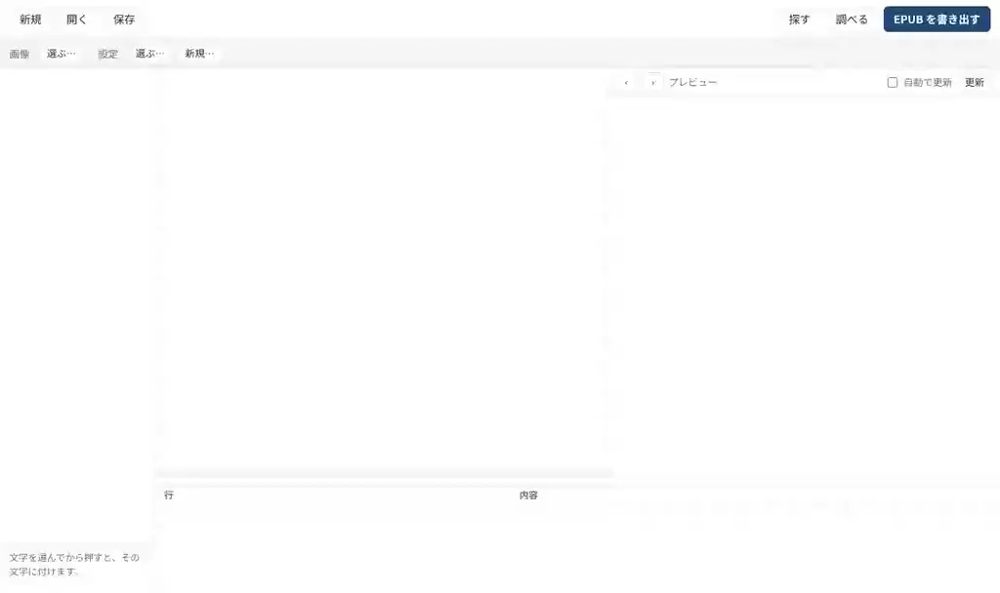
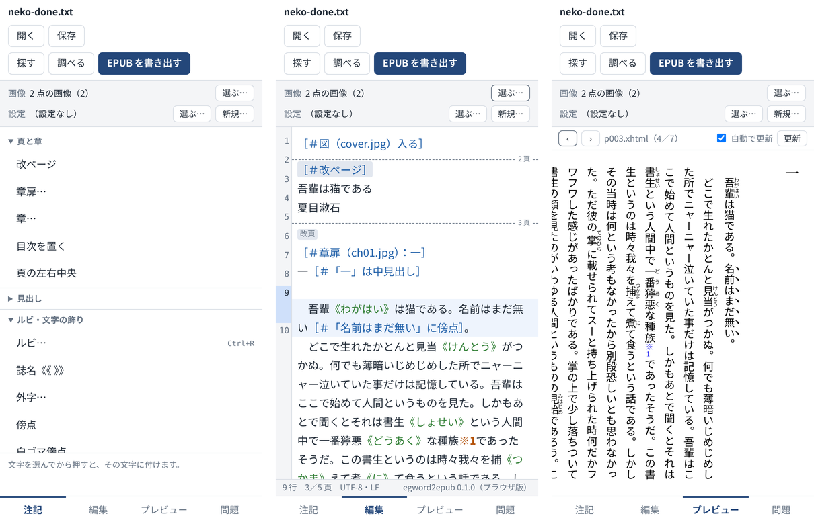

# Egword2EPUB の使い方

egword から書き出したテキストに注記を書き足し、縦書きの EPUB にするまでを、順に説明します。動画はブラウザ版で撮っていますが、Mac のアプリも同じ画面です。

通して見たいときは、[通しの動画（約 3 分）](media/tutorial.mp4)をどうぞ。

- [0. 用意するもの](#0-用意するもの)
- [1. テキストと画像を開く](#1-テキストと画像を開く)
- [2. 注記を入れる](#2-注記を入れる)
- [3. 書き損じを直す](#3-書き損じを直す)
- [4. 書名や作者を設定する](#4-書名や作者を設定する)
- [5. EPUB を書き出す](#5-epub-を書き出す)
- [6. スマホで使う](#6-スマホで使う)
- [困ったときは](#困ったときは)

## 0. 用意するもの

- **テキスト**：egword の「書き出し」でテキストにしたもの（UTF-8 か Shift_JIS）。ルビは `漢字《かんじ》`、改ページは改ページ記号として書き出されます。
- **画像**：表紙・章扉・挿絵の画像（JPEG・PNG など）。一つのフォルダにまとめておくと楽です。

試すだけなら、このリポジトリの [`sample/`](../sample/) にある見本（夏目漱石『吾輩は猫である』の冒頭と、表紙・章扉の画像）を使えます。この説明の動画も、この見本で撮っています。

アプリは二通りあります。

- **ブラウザ版**：[https://ktomoyukigit.github.io/egword2epub/](https://ktomoyukigit.github.io/egword2epub/) を開くだけ。何も入れなくて構いません。テキストや画像はどこにも送られず、ブラウザの中だけで変換します。
- **Mac のアプリ**：README の「Mac のアプリ」のとおりに組み立てます。開いたテキストにそのまま上書き保存でき、画像や設定もテキストごとに覚えてくれます。

## 1. テキストと画像を開く

1. 上の「**開く**」で、書き出したテキストを選びます。
2. 「画像」の「**選ぶ…**」で、画像を選びます。パソコンの Chrome・Edge とアプリではフォルダごと、ほかのブラウザでは画像をまとめて選びます。アプリでは、テキストと同じフォルダの画像を最初から使います。

窓は四つの欄に分かれています。

| 欄 | 中身 |
|---|---|
| 左 | **注記の一覧**。押すと注記が入ります |
| 中 | **エディタ**。頁の始まりに区切り線と頁の番号が出ます。注記は青、ルビは緑、注の参照は橙 |
| 右 | **縦書きのプレビュー**。カーソルのある頁を表示します。‹ › で頁を送り、注の番号を押すと注へ移ります |
| 下 | **問題の一覧**。変換したときの警告です |

プレビューは、書く手を止めて少したつと作り直されます。止めたいときは「自動で更新」を外し、「更新」で作り直します。

## 2. 注記を入れる

左の一覧から入れれば、注記の書き方を覚えていなくても構いません。

- **文字に付けるもの**（ルビ・傍点・太字・見出しなど）：文字を選んでから押します。選ばずに押すと、始めと終わりの印が入るので、その間に書きます。
- **行に付けるもの**（字下げ・地付き・中央揃えなど）：カーソルのある行、または選んだ行すべてに付きます。
- **一行で置くもの**（改ページ・図・章扉・区切り線など）：カーソルのある行の次に入ります。空の行で押すと、その行に入ります。

動画では、次のことをしています。

| すること | 操作 | 入る注記 |
|---|---|---|
| 表紙 | テキストの頭に空の行を作り、「図…」で `cover.jpg` を選び、「改ページ」 | `［＃図（cover.jpg）入る］` と `［＃改ページ］` |
| 章の始まり | 章の頭の空の行で「章扉…」。画像と、目次に使う題名を入れる | `［＃章扉（ch01.jpg）：一］` |
| 見出し | 「一」を選んで「中見出し」 | `一［＃「一」は中見出し］` |
| ルビ | 「書生」を選んで「ルビ…」（⌘R / Ctrl+R）、よみを入れる | `書生《しょせい》` |
| 傍点 | 「名前はまだ無い」を選んで「傍点」 | `名前はまだ無い［＃「名前はまだ無い」に傍点］` |

入れた注記は ⌘Z（Ctrl+Z）で一回ずつ取り消せます。ルビのように文字と注記をまとめて書き換えたものも、一回で元に戻ります。

注記の全体は README の「[テキストの書き方](../README.md#テキストの書き方)」にまとめてあります。

### 脚注と文末注

egword で付けた脚注と文末注は、書き出すと本文に `※1` や `[1]`、セクションの終わりに注の本文が並びます。そのままで、本文と注が相互にリンクした EPUB になります。見本にも脚注が一つ入っています。

## 3. 書き損じを直す

注記の書き損じ（閉じていない範囲、見つからない画像、どこにも付かない注記など）は、下の「**問題**」の一覧に出ます。変換は止まりません。

- 行を押すと、その場所へ移ります。
- 直したら「**調べる**」（⌘K / Ctrl+K）で一覧を作り直します。プレビューを自動で更新しているときは、少したつと自動でも作り直されます。

## 4. 書名や作者を設定する

書名・作者・発行日などは、設定ファイルに書いておきます。設定ファイルがなくても EPUB は作れますが、そのときの書名はテキストのファイル名になります。

1. 「設定」の「**新規…**」で窓を開きます（設定ファイルがあれば「**選ぶ…**」で選び、「**編集…**」で直します）。
2. 「**書誌**」に書名・作者などを入れます。作者は「＋ 作者を足す」で何人でも。役割は著・訳・編・絵から選びます。
3. 「**組版と注**」で、縦書き・横書き、CSS、注の書式などを選びます。ふつうはそのままで構いません。
4. 「**奥付**」に印を付けると、本の最後に奥付の頁ができます（書名・作者・発行日・発行者は書誌から取ります）。
5. 「**確かめる**」で書き損じを調べて、「**保存**」。

「**テキスト**」のタブでは、設定ファイルそのものを直せます。欄を変えずに保存したときは、設定ファイルに書いたコメントも残ります。

識別子は、同じ本を出し直すときに同じ本として扱ってもらうための番号です。「作る」で作ったものを変えずに使ってください。

ブラウザ版では、保存はダウンロードになります。次に使うときは「選ぶ…」で、設定ファイル（と、指定した CSS）を選びます。

## 5. EPUB を書き出す

「**EPUB を書き出す**」（⇧⌘E / Ctrl+Shift+E）で、EPUB ができます。大きな画像（長い辺が 2000px を超える JPEG・PNG。表紙は 2560px）は縮小して入れます。

できた EPUB は、Apple Books や Kindle Previewer などで開いて確かめてください。ストアに出すときは、[EPUBCheck](https://www.w3.org/publishing/epubcheck/) でも検査しておくと安心です。

テキストの保存は「**保存**」（⌘S / Ctrl+S）です。開いたときの文字コード（Shift_JIS か UTF-8）と改行の形を保ちます。

## 6. スマホで使う

ブラウザ版は、スマホ（Android など）のブラウザでも使えます。狭い画面では、下の「**注記**」「**編集**」「**プレビュー**」「**問題**」で欄を切り替えます。

- テキストと画像は、ファイルを選ぶ画面から選びます。
- 保存と EPUB はダウンロードになります。
- 書きかけのテキストはブラウザに残しておくので、うっかり閉じても、開き直したときに戻せます。

## 困ったときは

**文字化けする**
UTF-8 と Shift_JIS は自動で見分けます。それ以外の文字コードのテキストは、egword で UTF-8 で書き出し直してください。

**画像が「図版未着」になる**
画像を選んでいないか、注記の画像の名前と実際のファイル名が違っています（大文字・小文字も区別します）。問題の一覧に、見つからない画像の名前が出ます。

**目次に最初の頁しかない**
章の始まりの注記（「章扉…」「章…」）か見出しがないと、目次は作れません。問題の一覧にも出ます。

**縦書きのプレビューと、読書アプリでの見た目が違う**
縦書きの表示はアプリによって差があります。とくに「頁の左右中央」や字上げは、海外製のアプリで崩れることがあります。

**ブラウザ版で上書き保存できない**
上書き保存ができるのは、パソコンの Chrome・Edge だけです。ほかのブラウザでは、保存するとダウンロードになります。
